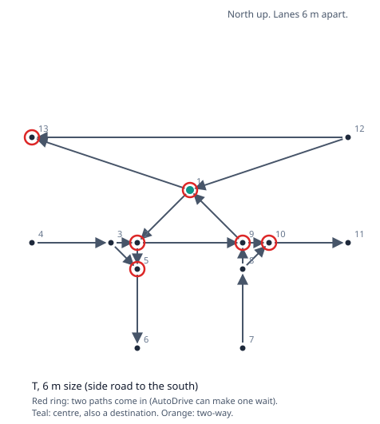
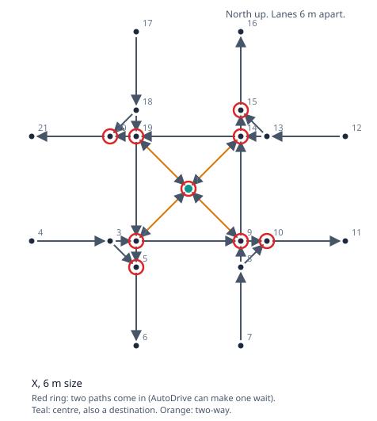
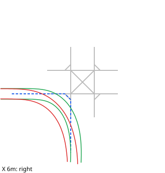
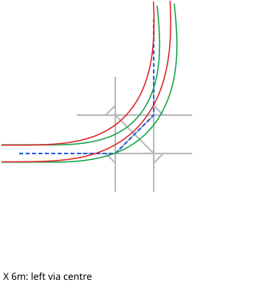
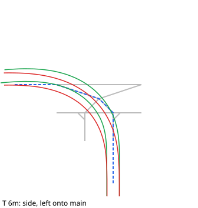
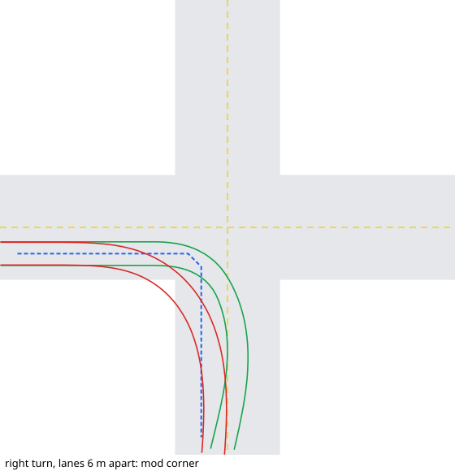
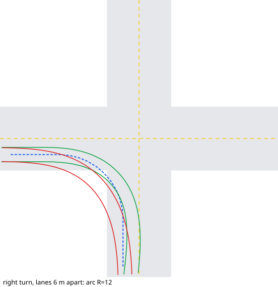

# Placeable X and T junctions: what they teach us

*Draft 1, 2026-10-01. Working notes for us.*

Our builder will make X and T junctions from scratch, with one click, and with no mod needed. Before we
design it, we studied the ready-made ones in Willi Willswissen's **FS25_AutoDrive_XT_Intersection**
(3.0.1.0, the combined X and T mod). We wanted to know three things: how they are built, how well a truck
drives them, and how AutoDrive decides who goes first. Sources and line numbers are in
[Placeable junctions: reference](05b-placeable-junctions-reference.md).

Nothing on this page ran in game. The drive results come from our steering twin (`SweptSim`) with the
captured truck and semi.

## What the pieces are

- **Eight pieces:** an X and a T, each in 3, 4, 5 and 6 m. The size is the **gap between the two lanes**.
- **One shape, scaled.** All four sizes are the same layout, just bigger. Each arm reaches 1.5 times the
  size out from the centre (9 m on the 6 m piece).
- **Paths only.** The piece paints no asphalt and levels no ground. It is AutoDrive paths plus some
  markers you see while placing it.
- **The centre point is also a destination.** Each piece placed adds one to the list, such as
  "9_xcrossing-6m-line". It is there only because AutoDrive's loader imports nothing from a piece
  without one. The author's own README says to delete it once the junction is joined, because it
  affects AutoDrive's route choice. It helps only while building, so you can send a driver straight to
  the junction. **Our builder does not need one** (see below).
- **A left-hand traffic version exists** (`FS25_AutoDrive_XT_Intersection_RHD.zip`). Not studied.

 

## How they are laid out

- **Straight on:** a plain one-way lane in each direction.
- **Right turn:** a short 45° cut across the corner, about 2 m long on the 6 m piece.
- **Left turn:** always through the **one centre point**.
  - T: both left turns cross there.
  - X: the four left turns all use it. The centre has two-way links to the four inner corners.
- **X corners:** each inner corner is where two straight lanes cross. It is not a loop.
- **The key idea: wherever two paths merge or cross, they share one point.** No two paths cross in
  open space. The next section shows why that matters.

## How AutoDrive decides who goes first

- **It only looks at shared points.** Each driver looks at its next few points. If another driver is
  near one of those same points and came in from a different direction, the first one waits.
- **Paths that cross without a shared point are invisible to it.** Then only the bumper sensor stops a
  crash, at short range.
- **No main road and no side road.** Nothing says "the main road goes first". The first driver to notice
  the other waits, unless the other is already waiting. Distance and who arrived first play no part.
- **Two-way stretches work like a one-lane road.** Before driving onto one, a driver checks the whole
  stretch ahead for anyone coming the other way. Once on it, the driver has right of way and stops
  checking, so everyone else gives way to it. This is on purpose: AutoDrive's own commit of 2025-12-30
  says "priority is granted proactively along the entire two-way route". The weak spot is that the check
  happens once, at the start of the stretch. Trucks that reach a junction further along later are never
  checked.
- **The teal dots are display only.** They mark points where paths come together. AutoDrive draws
  them and uses them for nothing else.

## Which turns AutoDrive will use

AutoDrive refuses any bend sharper than 80° from one link to the next, so some routes through a piece
are impossible.

- **Every straight, right and left turn works.**
- **U-turns never work** in either piece.
- **Left turns can only go through the centre.** Going "round the corner points" needs a 90° bend.
- **Opposite left turns on the X share one line,** in opposite directions. So they take turns. Two
  never turn left at the same time.
- **Route choice:** AutoDrive picks the quickest drive, slowing for sharp bends. By default the centre
  destination costs nothing to drive through.

## How a truck really drives them

 

*North up. Grey: the piece's paths. Blue dashes: the path driven. Green: truck wheels. Red: trailer
wheels.*

- **Size makes almost no difference.** The 3 m and 6 m pieces drive almost the same line. The truck
  steers at a point about 10 m ahead, so it never sees the small corner shapes.
- **Right turns:** the truck swings about 3 m wide into the new road's oncoming lane. The trailer's
  wheels cut the inside corner by up to 4.6 m.
- **Left turns:** run 2-3 m wide on the far side. The trailer cuts the inside by 3.5-4.5 m.
- **Turn speed: 12 km/h.** Every turn has a 45° bend somewhere, and that caps the speed. An earlier
  draft said 21-27 km/h. That came from our twin, which looks only 20 m ahead for bends and so brakes
  late. AutoDrive 3.0.1.2 looks further ahead (see "How point spacing sets the speed").
- **Straight on:** clean, full speed.
- **One rig only.** A smaller tractor looks less far ahead (AutoDrive allows down to 2 m), so it would
  follow the corners more closely. Not tested.

## Real curves against sharp corners

We drove the same truck through a curve laid the way our builder lays one (a plain arc between the
two lanes, points 2 m apart) and compared it with the mod's corner. The roads are a simple model: two
straight roads crossing, a lane wide each side of the middle line, square corners.

 

*Grey: road. Yellow: middle lines. Blue dashes: the laid line. Green: truck front corners. Red:
trailer wheels.*

Lanes 6 m apart, our default 12 m curve against the mod:

| | Right turn: curve | Right turn: mod | Left turn: curve | Left turn: mod |
|---|---|---|---|---|
| Truck cuts inside the line | 0.7 m | 2.0 m | 0.7 m | 1.3 m |
| Trailer strays from the line | 1.7 m | 3.3 m | 1.7 m | 2.3 m |
| Truck swings wide of the line | 2.1 m | 2.7 m | 2.1 m | 2.3 m |
| Wheels into oncoming lane | 1.5 m | 2.3 m | 0.4 m | 0 |
| Wheels off a square corner | 2.6 m | 1.3 m | 1.5 m | 1.7 m |
| Slowest | 39 km/h | 12 km/h | 37 km/h | 12 km/h |

What it shows:

- **The truck follows a curve.** The trailer strays about half as far. So, unlike the mod, the line we
  lay decides where the truck goes. That makes getting the line right worth the effort.
- **The curve has to fit the road.**
  - With square corners, a right-turn curve bigger than about 1.7 times the lane gap leaves the road
    itself: 10 m for 6 m lanes, 7 m for 4 m, 5 m for 3 m. The last is tighter than this truck can turn
    (6.3 m).
  - A left-turn curve that is too big cuts across the oncoming lane before the junction.
  - So one fixed 12 m will not suit every junction. The size should come from the paved area, which ties
    in with the centre work (doc 04).
- **A nice fit with "left turns one at a time":** at 1.7 times the lane gap, both opposite left curves
  pass exactly through the centre. That is one shared point, like the mod's.
- **AutoDrive barely slows on a smooth curve.** It slows for the bend between neighbouring points, and a
  curve with points 2 m apart has almost none. It takes our 12 m turn at 37-39 km/h. The mod's corners
  bring it down to 12 km/h. We chose 20-25 km/h (next section).
- **The truck still swings about 2 m wide** on every curve, at any speed. That comes from how AutoDrive
  steers, so the builder should leave room for it on the outside of each turn.

## How point spacing sets the speed

AutoDrive never looks at how tight a curve is. It looks at the **bend at each point**: the angle
between the link coming in and the link going out. It finds the sharpest bend coming up and caps its
speed by it:

| Sharpest bend ahead | Speed cap |
|---|---|
| under 5° | none |
| 5° to 30° | 60 km/h falling evenly to 12 km/h |
| 30° to 50° | 12 km/h |
| 50° or more | 3 km/h |

On a curve, the bend at each point is about **spacing ÷ radius** (in radians; ×57 for degrees). So
the same curve can be fast or slow depending on how many points it has:

| Points in a right-angle turn | Bend at each | Speed cap |
|---|---|---|
| 1 (a sharp corner) | 90° | 3 km/h |
| 2 or 3 | 45° or 30° | 12 km/h |
| 4 | 22.5° | 26 km/h |
| 5 | 18° | 35 km/h |
| 6 | 15° | 41 km/h |
| 8 or more | 11° or less | 48+ km/h |

Our builder lays a point every 2 m, so a 12 m turn has about 10 points and almost no cap.

**Even spacing cannot hit 20-25 km/h on a right-angle turn.** The point count has to be a whole
number, so the speed jumps straight from 12 km/h (3 pieces) to 26 km/h (4 pieces).

**One deliberate bend can.** Only the single sharpest bend counts. So lay the curve with normal 2 m
points, and make the **last two pieces** of the curve each turn by the target bend:

| Target | Bend at that one point |
|---|---|
| 20 km/h | 25.8° |
| 22 km/h | 24.8° |
| 25 km/h | 23.2° |

- Every point stays on the curve, so the shape does not change.
- The bend sits at the end because AutoDrive only counts bends still ahead of it. At the end, the
  bend holds the speed down all the way round.
- Tested in the twin with a realistic look-ahead: 8, 10 and 12 m right curves aimed at 20 km/h all took
  exactly 20 km/h. Left curves aimed at 22, 23 and 25 km/h took exactly those.

Things to know:
- **It slows down in time.** AutoDrive looks for bends further ahead the faster and heavier it is
  (20 m up to 150 m), so it brakes before the turn and speeds up after.
- **The player's "corner speed" setting multiplies the cap.** Our choice scales with theirs.
- **Wheels near full lock cap it at 10 km/h anyway,** so very tight turns slow down on their own.
- **Spacing also changes when drivers notice each other.** The "who waits" check counts points, not
  metres: a driver looks 5 points ahead. At 2 m spacing that is only 10 m; at 5 m it is 25 m. Wider
  spacing inside the junction means drivers spot each other earlier.
- **AutoDrive only brakes hard once it is more than 6 km/h over the cap.** Below that it lets the
  speed fall off on its own. The twin does not model this, so real trucks may run a few km/h faster
  than aimed. Check in game.

## Hooking them up today

- **AutoDrive loads the paths once, when you place the piece.** It does not reload them, so a reload
  makes no copies.
- **It never joins them to your roads.** The ends stay loose until you join them by hand.
  - In our save the T is joined with short links about 5 m out. The X is not joined at all.
- **Selling leaves everything behind:** the paths, the links and the destination.
- **Placing another one adds a new set** with its own destination.

## Small faults in the mod

- The 5 m and 6 m T name their destination "xcrossing".
- Two "0 m" models ship with no piece using them.

## What our builder must keep

1. **One shared point wherever two paths merge or cross.** Without it, AutoDrive never makes anyone
   wait.
2. **No bend over 80° on any route we mean to allow.** We can also use the same rule to block moves on
   purpose, the way these pieces block U-turns.
3. **One-way links inside the junction.** On a two-way link AutoDrive stops looking for traffic.
4. **Lay real curves, sized to fit both the truck and the paved area.** The truck ignores a sharp corner
   but follows a curve, so the curve decides where the wheels go. Leave about 2 m spare on the outside of
   each turn.
5. **No destination at the centre.** Nothing in driving, waiting or routing needs one. We write
   points straight into the network, so the loader's rule does not apply to us. A destination there
   does harm:
   - it clutters the list and outlives the junction;
   - if a player raises the "destination detour" setting, every route through the junction pays it;
   - AutoDrive picks the nearest destination to a fuel, repair or selling point, so a junction near
     one could be picked as that stop (up to 15 m away for fuel and repair).
6. **Join the ends as part of the build,** and record what we joined so undo and rebuild can take it
   back. That is the one thing the mod cannot do.

## Decided (2026-10-01)

1. **Left turns go one at a time, like the mod.** Opposite left turns share one point, so AutoDrive
   makes one wait.
2. **U-turns are blocked, like the mod.**
3. **Curve size is picked per junction from the paved area,** not one fixed setting.
4. **Turn speed 20-25 km/h, slower for right turns and tight curves.** Proposed numbers, set by one
   deliberate bend at the end of each curve:
   - right turns: 20 km/h;
   - left turns: 25 km/h on curves of 15 m or more, easing down to 20 km/h at 8 m;
   - very tight turns drop to 10 km/h on their own (full lock).

## Still open

1. **Check in game:** confirm the 80° rule and the "who waits" rule with two trucks at the placed X once
   it is joined.
