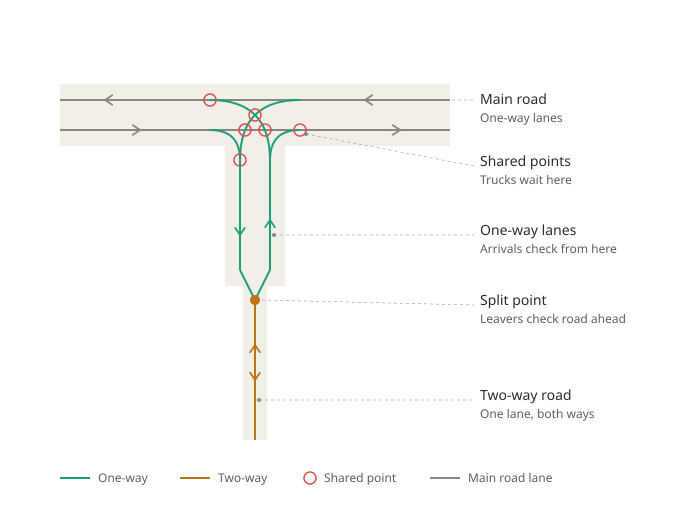
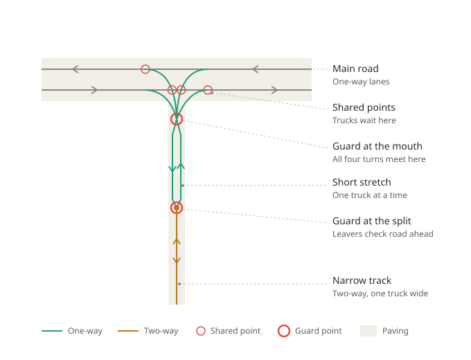

# Junction build (two clicks)

*Draft 1, 2026-10-01. Working notes for us. Spec, nothing built.*

Two clicks on a junction clear it, lay new turns and hook them up, all as one undo. The first click
locks the site and shows the plan; the second builds. It builds from scratch with no mod needed. It
follows the rules we took from the placeable X and T ([Placeable X and T junctions](05-placeable-junctions.md)),
and it uses the clear's centre, box and stubs ([What the builder needs](02-what-the-builder-needs.md)).

**Version 1 covers square X and T junctions only.** Skew T, Y and corner T come after.

## What you do

1. **Point at a junction.** It can be an existing one, messy or already cleared, or a bare crossing
   where roads meet with nothing joining them yet.
2. **First click locks the site.** The card shows the kind (X or T, detected), the centre, and every
   turn it will lay, coloured by whether it passes. If the kind is wrong you can switch it. Switching
   an X to a T leaves the arm you drop untouched, for example a field entrance.
3. **Second click builds.** It clears, builds and hooks up. One undo takes it all back. Right-click
   lets go of the site without building.

If something needs you, the second click does not build. The card says what and offers the choices
(see "When it stops and asks").

## What one click does

1. **Pick the site.** Same picker as the clear: centre, box and kind.
2. **Clear** what is there (skipped on a bare crossing). The middle ends up empty and the stubs reach
   in to the other road's paved edge.
3. **Measure:** lane gap, paved area, which roads are one-way.
4. **Lay the turns** by the rules below.
5. **Check everything** (see "Checks before it commits"). Any failure means nothing is built.
6. **Commit** as one undo, and save the junction's description.

## The layout rules

From doc 05. Each one is there because of how AutoDrive drives:

1. **Every merge or crossing of two paths is one shared point.** AutoDrive only makes a driver wait at
   a shared point.
2. **Every link inside the junction is one-way.** On a two-way link AutoDrive stops checking for
   traffic.
3. **Left turns go one at a time.** Opposite left turns share a point, so one waits for the other.
4. **No U-turns.**
5. **No destination at the centre.**
6. **Kept through roads at an X share a point where they cross** (decided 2026-10-01; replaces doc 02's
   "nothing joins them").
7. **Every turn AutoDrive could use must be one we meant** (see "The route check").

## Which turns it lays

- **T:** both straights stay, plus the right and left turn into the side road, and the right and left
  turn out of it.
- **X:** all four straights stay, plus a right and a left turn from each road.
- **One-way roads:** only the moves the directions allow.
- **No U-turns,** ever.

## How each turn is shaped

- **A real curve,** not a corner. The truck follows a curve, so the curve decides where the wheels go.
- **The size comes from the paved area at this junction.** It is the largest curve whose line stays on
  the paving, checked with the truck twin. It must also leave about 2 m spare on the outside, where the
  truck swings wide.
- **The speed comes from one deliberate bend** at the end of each curve. The last two pieces of the
  curve each turn by the bend for the target speed:
  - right turns: 20 km/h;
  - left turns: 25 km/h on curves of 15 m or more, easing down to 20 km/h at 8 m.
- **Points inside the junction are as far apart as the speed allows.** The bend at each must stay under
  the deliberate one. Wider spacing means drivers see each other further ahead (the "who waits" check
  looks 5 points ahead, not a distance).
- **Where a turn starts and ends:** on the lane, at a point shared with the lane. A turn starts where
  it leaves the lane and ends where it joins its exit lane.

## Opposite left turns

- **Usually they cross on their own.** Each crossing gets a shared point, so they go one at a time.
- **If they would pass without crossing** (small curves on wide roads), both are routed through the
  centre point instead: a curve onto the diagonal, through the centre, and a curve off it. That is the
  mod's shape, made smooth.
- At a curve of 1.71 times the lane gap, both pass exactly through the centre with no straight piece.

## The route check

A shared point lets AutoDrive switch from one path to another whenever the bend there is 80° or less.
So two turns that cross at a shallow angle create a new route nobody laid.

- **Found offline:** at an X with lanes 6 m apart and curves of 8 m or less, the eastbound left and the
  northbound left cross at 65-77°. AutoDrive could hop from one to the other, and one of those hops is a
  **U-turn**. The T's two left turns have the same risk. At 9 m and up they cross at 84° or more.
- **So before committing, the builder lists every route AutoDrive could take** through the junction,
  using AutoDrive's own 80° rule. Each must be one of the turns it meant to lay. A harmless wiggle that
  ends where a laid turn ends is allowed.
- **If an extra route turns up,** it tries a bigger curve for one of the two turns. If that cannot fit
  the paving, it stops and shows why.

## Bare crossings

- **Two roads crossing with nothing joining them (X):** add the shared points where the through lanes
  cross, then lay the turns.
- **A side road stopping short of the main road (T):** carry its lanes in as stubs to the main road's
  paved edge, then lay the turns.
- **Roads that do not reach each other at all:** not a junction. Refuse, and say so.

## Two-way roads

AutoDrive treats a two-way stretch like a one-lane road. Before entering it, a truck checks the whole
stretch ahead for anyone coming the other way. Once on it, the truck keeps right of way and stops
checking (doc 05). So a two-way road that runs straight into a junction brings in trucks that never
check there.

**The fix: split every two-way arm into two one-way lanes for its last stretch before the junction.**
The junction itself is then built like any one-way junction.

- **Trucks coming in** move onto their own one-way lane at the split, and check normally from there.
- **Trucks going out** still get AutoDrive's own check of the whole two-way road ahead, at the split.
  If someone is coming, they wait on their lane, clear of the junction.
- **The split sits about 20 m before the junction** (to measure), so a truck has room to stop between
  the split and the mouth.

Two versions, picked by the paved width at the mouth (the same paving reading that sizes the curves):

**Room for two trucks side by side:** two separate short lanes, a normal lane width apart. Trucks pass
each other on the short stretch like on any two-lane road.

**Room for one truck:** the two short lanes join again at one **guard point** at the mouth, where all
the turns start or end. The guard at the mouth and the split guard the short stretch from both ends,
so only one truck is ever on it. A truck turning in waits at the mouth while one is coming out, and the
other way round.

- The guard point opens no new routes. Lane in to lane out is a 180° bend, and so is turn to turn, so
  AutoDrive refuses both. The route check confirms it on every build.
- The cost is one truck in the mouth at a time, which is how a one-truck-wide track works anyway.

## When it stops and asks

- **No curve fits the paving** for a turn: show the best two or three options with a short reason each.
  You pick or cancel. This is the same as the clear's failed grade.
- **A named destination or a reverse road inside the junction:** show it, then keep, delete or cancel
  (doc 02, decision 6).
- **The route check finds an extra route it cannot fix:** show which, and do not build.
- **The kind looks unsure** (for example a fourth arm that might be a field entrance): show what it
  thinks, and let you switch.

## Checks before it commits

1. **The route check** (above).
2. **No two paths cross without a shared point.**
3. **No two-way link** inside the box or between the split and the box.
4. **No destination** inside the box.
5. **The truck twin drives every turn:** wheels on the paving with the spare room, speed in its band.
6. **Nothing outside the junction changed.**
7. **The teal dots** AutoDrive would draw match the merges and crossings we meant.

## Settings

- Target speeds: right turns, and left turns at small and large curves.
- Spare room on the outside of a turn (default 2 m).
- Through roads kept or not (existing setting).
- Signs as obstacles (existing setting).

## What we reuse, and what is new

The clear and today's builder already do much of this. Line numbers are `FlyoverEditor.lua` on this
branch.

**Reuse as it is:**

- **The picker** (`junctionSelect`, 10538). It already sees bare and cleared sites: a ring of loose lane
  ends counts as a junction (`junctionVirginSites`, 10341).
- **The clear** (`applyJunctionClear`, 22030): cleaning, smoothing, cutting, and stubs at the paved edge
  (`junctionTidyLaneEnds`, 14921).
- **Kind, centre and lane gap** (`junctionClassify`, 18205; box centre; lane gap from the lanes,
  15415).
- **The U-turn filter:** turns whose headings differ by more than 170° are never made (13185).
- **The curve solver and truck test** (`junctionSolveMovement`, 14485). It starts at the turn-radius
  setting and steps down until the curve stays on the road, misses obstacles and passes the truck twin.
  That is "the largest curve that fits", with the setting as the ceiling.
- **Tie-ins** (`junctionTieIn`, 14778): splice a turn's ends into its lanes.

**Change:**

- **Curve ceiling from the paved area,** not the 12 m setting, so wide junctions get bigger curves.
- **Point spacing after the solve:** the solver spaces points by smoothness (about 1.5 m). The
  builder then sets the deliberate speed bend and widens the spacing inside the box.
- **Two-way turns:** today the builder lays a two-way turn where a two-way road comes in (22602). That
  goes. Two-way arms are split before the junction instead (see "Two-way roads").
- **The saved description:** today the registry keeps only the number and position (11063). Doc 02 decided
  the clear saves its description; that is still to build.
- **One undo for everything.** Today the clear cleans and smooths the site before it takes its undo
  snapshot (22080-22133, then 22233), so undo cannot bring those changes back. Flagged as its own fix.
  The build must take one snapshot before anything changes.

**New:**

- **Shared points where paths cross.** Today each turn is tied in on its own. Ends are only shared if
  they land within 0.35 m (14825), and crossings get nothing.
- **Opposite left turns through one point** when they would not cross.
- **The route check.**
- **The speed bend.**
- **The two-way split,** in both versions.
- **A build entry in the offline harness, and a build regression.** Today the harness can only run the
  clear (`harness.lua` `M.apply`), so building has no offline test at all.

## Not in version 1

- Skew T, Y and corner T.
- Left-hand traffic maps. These would be a mirror image; the mod ships a separate version for them.
- Bridges, multiplayer, roundabouts.
- Which turns to leave out (a player setting, later).

## How we test it

- **Offline, on the square X and T sites in the 75-site registry:** run all the checks above. Drive
  every turn in the truck twin, after its bend scan is brought up to AutoDrive 3.0.1.2.
- **In game:**
  - two trucks meeting at a built X and at a T, to confirm who waits;
  - the turn speeds against their targets;
  - that AutoDrive refuses the routes the route check says it refuses.

## Decided

- 2026-10-01:
  - It works on existing junctions and on bare crossings.
  - The tool detects X or T, and you can switch it. Switching an X to a T leaves the dropped arm
    untouched.
  - Version 1 is square X and T only.
  - Kept through roads at an X share a point where they cross.
  - Two clicks: the first locks the site and shows the plan, the second builds.
- 2026-10-02: two-way arms are split into two one-way lanes before the junction. Room for two trucks
  gives two separate lanes; room for one gives two lanes joined at a guard point at the mouth. This
  replaced two other options:
  - one two-way turn (today's): trucks off the two-way road never check at the junction;
  - two one-way turns on the same line: those trucks only start checking about 6 m before the turn.

## Still open

1. **How far before the junction the split sits.** About 20 m proposed: room to stop between the split
   and the mouth. To measure with the truck twin.
2. **The width that counts as "room for two trucks"** at the mouth. Two of the captured truck side by side
   is about 5.4 m plus clearance, so about 6.5 m of paving is proposed. To check.
3. **Two junctions close together on one two-way road,** where their splits would overlap.
