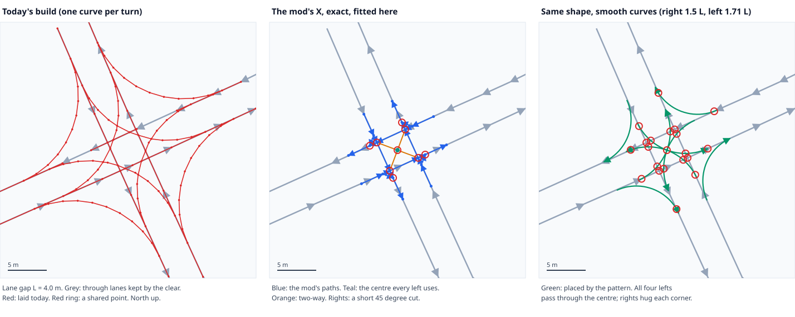

# Junction build by pattern

*Draft 1, 2026-10-02. Working notes for us. Spec, nothing built.*

## Why

The first in-game test (build 1.0.2.0+438) showed the builder does not lay the X and T we studied in
[doc 05](05-placeable-junctions.md). It still fits one curve per turn on its own, then adds shared points
and the route check on top. The turns come out big and sweep far past the junction, and the left turns
never meet at a centre.

*j11, a square crossroads with lanes 4 m apart. Drawn by `tools/xt-study/fitpattern.py` from
`tools/junction-harness/dump_build.lua`.*

## What changes

The builder **places the pattern**, fitted to the junction, instead of fitting each turn alone.

1. **Find the frame.** After the clear, the kept through lanes cross at the inner corners (four at an
   X). The centre is the middle of the corners, the lane gap L is their spacing, and the lane
   directions give the frame.
2. **Place the pattern in that frame:**
   - a shared point at each inner corner, where two through lanes cross;
   - one right turn at each outer corner;
   - every left turn through the one centre point.
3. **Hook up.** Each turn starts and ends on a lane, at a point it shares with the lane.
4. **Heights from the ground.** Every new point takes the ground height where it stands. (In game,
   some of today's points ended up below the surface.)
5. **Few points.** The pattern's own points, plus curve points only as close as the speed needs.
6. **The route check stays.** It still lists every route AutoDrive could take and flags any we didn't mean.

Kept from today's builder: the clear, shared points, two-way roads to the mouth, the route check.

## Choice A: the mod's exact shape, or smooth curves

| | Mod's exact shape (middle) | Smooth curves (right) |
|---|---|---|
| Looks like | the mod's X | the mod's X, rounded |
| Points | few | more |
| Turn speed | about 10-12 km/h (45° corners) | faster |
| Centre links | two-way spokes from the centre to the corners | one-way everywhere |
| Shared points at j11 | 9 | about 20 (adjacent left curves cross each other too) |

- **Exact:** proven in the mod. But the spokes are two-way, which breaks layout rule 2 in doc 06:
  on a two-way link AutoDrive stops checking for traffic.
- **Smooth:** keeps every link one-way. But adjacent left curves cross each other at shallow angles,
  which is exactly where AutoDrive can switch paths. The route check would have to catch those.

## Choice B: size

At j11 the lanes are 4 m apart, so the mod's X is only 12 m across. A truck and trailer swing wide on
either version. Version 1 sizes from the lane gap; sizing from the paved area comes later.

## Scope

- Version 1: square X only. T next, from the same frame with two inner corners.
- Offline first: j11 and the 75-junction regression in the harness.
- In game later, around j39 (some of it may be too complicated at first).

## Decided (2026-10-02)

- **A: both.** The card picks the shape: the mod's exact X, or the same pattern with smooth curves.
  Why both: once the swing-wide sizing is built, it needs the shared-point holds built into it, so
  the pattern (where paths share points) is the base both shapes stand on.
- **B: size from the lane gap** for now (smooth: rights 1.5 L, lefts 1.71 L). The paved area comes later.

## Still open

- What to do where the four inner corners are not found (no kept through lanes, a bare crossing).
